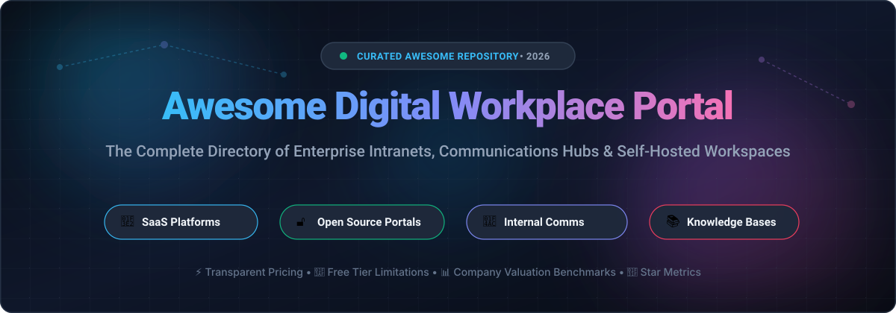
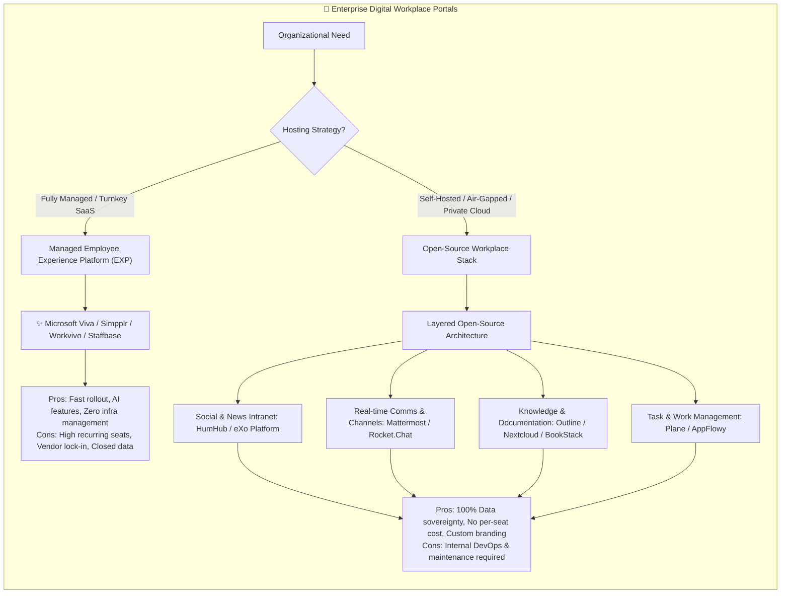

# 🌐 Awesome Digital Workplace Portal 🚀

**Curated collection of SaaS products and open-source self-hosted solutions for enterprise intranets, employee experience platforms (EXP), communications hubs, and knowledge portals.**

[Explore SaaS Solutions](#-saas--hosted-platforms) • [Explore Open-Source Repositories](#-open-source-github-projects) • [Sector Dynamics](#-sector-overview--market-dynamics) • [Contributing](#-how-to-contribute)

---

## 📑 Table of Contents

- [📌 Sector Overview & Market Dynamics](#-sector-overview--market-dynamics)
- [🏢 SaaS / Hosted Platforms](#-saas--hosted-platforms)
- [🔓 Open-Source GitHub Projects](#-open-source-github-projects)
- [⚖️ Platform Comparison & Architecture Matrix](#️-platform-comparison--architecture-matrix)
- [🤝 How to Contribute](#-how-to-contribute)
- [💖 Support & Sponsorship](#-support--sponsorship)
- [📊 Star History](#-star-history)
- [🛡️ Disclaimer & Data Governance](#️-disclaimer--data-governance)

---

## 📌 Sector Overview & Market Dynamics

The global **Digital Workplace Market** is valued between **$46B and $60B** and projected to exceed **$80B+** (growing at ~19–23% CAGR), fueled by pervasive hybrid work models, AI-assisted productivity, and enterprise cloud migrations. The sector displays a **dual-dynamic structure**: broad market concentration is **moderately fragmented** with specialized SaaS vendors and open-source stacks addressing employee engagement, internal comms, and wikis, while the underlying core ecosystem is **heavily concentrated** around mega-suite providers (Microsoft 365, Google Workspace, and Atlassian) who anchor enterprise collaboration budgets.

---

## 🏢 SaaS / Hosted Platforms

Below is a curated breakdown of enterprise digital workplace platforms, employee communication hubs, and digital employee experience (DEX) software. The table is ranked by company scale (valuation / annual revenue in descending order) and provides specific starting prices, free tier limits, and target use cases.

| 🏢 Platform | 💰 Company Scale (Valuation / Revenue) | 🏷️ Specific Starting Pricing | 🎁 Free Tier / Trial Limits | 🎯 Target Fit & Key Trade-offs |
| :--- | :--- | :--- | :--- | :--- |
| **[Microsoft Viva Connections](https://www.microsoft.com/en-us/microsoft-viva/connections)** | **~$3.1 Trillion Market Cap** (Microsoft parent) / **~$245B+ Annual Revenue** | **Included in M365 Business Basic** at **$6.00/user/month** (Viva standalone suite add-on: **$12.00/user/month**) | **Included with M365 subscription** (requires active paid Microsoft 365 tenant; free 30-day trial of M365 available for up to 25 users) | **Best for:** Microsoft 365 environments wanting an integrated hub in Teams. ⚠️ **Trade-off:** Deeply coupled to the Microsoft ecosystem. |
| **[Atlassian Home](https://www.atlassian.com/software/home)** | **~$45–55 Billion Market Cap** / **~$4.4B+ Annual Revenue** | **Included with Jira / Confluence** (Confluence Standard starts at **$5.78/user/month**; Jira Standard starts at **$9.70/user/month**) | **Free forever plan available** (strictly capped at **10 users**, **2 GB total storage**, and community-only support across Jira/Confluence) | **Best for:** Engineering, product, and agile organizations built around Confluence & Jira. ⚠️ **Trade-off:** Wiki/task-centric rather than traditional social intranet. |
| **[Workvivo](https://www.workvivo.com/)** | **$221.8 Million Acquisition** (by Zoom Video Communications; Parent Market Cap ~$20B+) / **$100M+ ARR** | **Business Plan starts at ~$20,000/year** (covers 250–2,000 employees; custom quote above 2,000 users) | **No permanent free tier** (offers customized guided pilot demos for qualifying enterprise buyers; no open self-serve trial) | **Best for:** Organizations wanting a vibrant, social-feed intranet with mobile-first live streaming. ⚠️ **Trade-off:** Steep ~$20k/yr entry commitment. |
| **[Staffbase](https://staffbase.com/)** | **$1.1 Billion Valuation** (Unicorn status) / **~$190M Annual Recurring Revenue (ARR)** | **Starts at ~$8.00–$14.50/user/month** (volume-tiered, annual commitment required; custom enterprise contracts) | **No permanent free tier & no public self-service trial** (evaluation strictly through vendor consultation and scheduled sandbox demos) | **Best for:** Enterprises managing frontline, mobile, and deskless workforces alongside desk employees. ⚠️ **Trade-off:** Long sales-cycle and enterprise annual contracts. |
| **[LumApps](https://www.lumapps.com/)** | **$650 Million Valuation** (Acquired by Bridgepoint; merged entity valued at **$1B+**) / **~$70M–$150M ARR** | **Starts at ~$8.00–$20.00/user/month** (annual Per-User-Per-Annum procurement licenses; custom quote) | **No permanent free tier & no open free trial** (must book a personalized proof-of-concept / demo directly with enterprise sales) | **Best for:** Enterprises needing seamless two-way integrations with Google Workspace & Microsoft 365. ⚠️ **Trade-off:** Requires enterprise onboarding and custom scoping. |
| **[Simpplr](https://www.simpplr.com/)** | **$280 Million Valuation** (Series D) / **$131M Total VC Funding Raised** | **Starts at ~$8.00–$15.00/user/month** (volume-based pricing with tier discounts starting at 500+ employees; annual billing) | **14-day free trial** (limited evaluation spaces available upon sales approval; no permanent free tier) | **Best for:** Mid-market and enterprises seeking AI-native knowledge discovery and automated sentiment analytics. ⚠️ **Trade-off:** Strict sales-assisted vetting with no instant self-serve checkout. |
| **[Unily](https://www.unily.com/)** | **~$73 Million Annual Revenue** / **$68M+ Growth Funding** | **Enterprise packages start at ~$150,000/year** (scaling per user based on internal employees, extranet users, and AI modules) | **No permanent free tier & no free trial** (requires guided enterprise RFP process and custom proof-of-concept) | **Best for:** Global 2000 corporations demanding deeply branded, secure omni-channel employee portals. ⚠️ **Trade-off:** High minimum contract floor designed for large-scale deployments. |
| **[Interact Software](https://www.interactsoftware.com/)** | **~$36 Million Annual Revenue** (Independent PE-backed mid-market player) | **Starts at ~$8.00–$10.00/user/month** (billed annually via direct contracts or AWS Marketplace; tailored by add-ons) | **No permanent free tier & no self-service trial** (custom interactive demos provided upon enterprise qualification) | **Best for:** Medium to large corporations requiring powerful internal communications analytics and governance. ⚠️ **Trade-off:** Add-ons (e.g. specialized mobile app features) scale costs quickly. |
| **[MangoApps](https://www.mangoapps.com/)** | **Private / Bootstrapped** (~$15M–$25M Estimated ARR) | **Basic Plan starts at $99/month** (includes first 25 users; **$4.00/user/month** for additional users; Standard at $149/mo) | **14-day full-featured free trial** (no credit card required; access to full portal features; no permanent free tier) | **Best for:** Mid-sized businesses wanting an all-in-one portal combining intranet, LMS, and team messaging. ⚠️ **Trade-off:** Interface can feel broad and feature-dense for teams seeking a single simple tool. |
| **[Jostle](https://jostle.me/)** | **Private / Growth Stage** (~$10M–$20M Estimated ARR) | **Bronze Plan starts at $4.00–$5.00/user/month** (billed annually; 15% surcharge for monthly billing; Silver tier at $8/user/mo) | **30-day free trial** (unlimited access to core features and mobile apps; no permanent free plan) | **Best for:** SMBs and mid-market organizations seeking a people-centric directory and bulletin intranet without complex setup. ⚠️ **Trade-off:** Lacks advanced custom workflow orchestration tools. |

---

## 🔓 Open-Source GitHub Projects

Curated self-hosted digital workplace portals, community intranets, team collaboration engines, and enterprise knowledge hubs. Sorted in descending order by **GitHub Stargazers Count**.

| 📦 Repository & Project | 🌟 GitHub_Stars_Badge | 💻 Tech Stack & License | 📝 Overview & Core Strengths |
| :--- | :--- | :--- | :--- |
| **[AppFlowy](https://github.com/AppFlowy-IO/AppFlowy)** |  | `Flutter` • `Rust` • `AGPL-3.0` | **Open-source Notion alternative for workspaces & knowledge bases.** Gives teams complete data sovereignty, native desktop/mobile apps, customizable Kanban, document wikis, and offline-first capabilities. |
| **[AFFiNE](https://github.com/toeverything/AFFiNE)** |  | `TypeScript` • `Rust` • `MIT` | **Next-generation multimodal digital workplace and knowledge portal.** Integrates planning, docs, mindmaps, and infinite whiteboard canvases into a single privacy-first collaborative hub. |
| **[Plane](https://github.com/makeplane/plane)** |  | `TypeScript` • `Python` • `AGPL-3.0` | **Modern open-source enterprise project workspace & tracking portal.** Self-hosted alternative to Jira and Linear featuring rich document pages, cycle tracking, roadmaps, and modular team views. |
| **[Discourse](https://github.com/discourse/discourse)** |  | `Ruby on Rails` • `Ember.js` • `GPL-2.0` | **Modern internal community forum & organizational discussion hub.** Industry standard for company-wide asynchronous knowledge sharing, town halls, categorized discussions, and robust SSO integration. |
| **[Rocket.Chat](https://github.com/RocketChat/Rocket.Chat)** |  | `TypeScript` • `Node.js` • `GPL-3.0` | **Enterprise communications hub & collaboration platform.** Secure on-premise communications portal with team channels, Matrix federation, omni-channel customer bridge, audio/video conferencing, and compliance controls. |
| **[Outline](https://github.com/outline/outline)** |  | `TypeScript` • `Node.js` • `BSL-1.1` | **Fast, intuitive internal knowledge base and team documentation portal.** Features markdown-native editing, real-time collaboration, nested document collections, SSO (OIDC/SAML), and enterprise access controls. |
| **[Mattermost](https://github.com/mattermost/mattermost)** |  | `Go` • `React` • `AGPL-3.0 / Apache-2.0` | **High-trust self-hosted workplace collaboration suite.** Combines team messaging, automated playbooks, audio boards, and integrated Kanban workflows tailored for technical, defense, and regulated environments. |
| **[Directus](https://github.com/directus/directus)** |  | `TypeScript` • `Node.js` • `BSL-1.1` | **Real-time data engine & flexible internal portal builder.** Turns any SQL database into an extensible internal operations portal, company intranet backend, and admin dashboard with granular role permissions. |
| **[Nextcloud Hub](https://github.com/nextcloud/server)** |  | `PHP` • `JavaScript` • `AGPL-3.0` | **Comprehensive on-premise content collaboration & intranet portal.** Seamlessly bundles private file sync/storage, Nextcloud Talk (video/chat), Nextcloud Groupware (calendar/mail), and collaborative document editing. |
| **[Wiki.js](https://github.com/requarks/wiki)** |  | `JavaScript` • `Node.js` • `AGPL-3.0` | **Lightweight, modern wiki engine for corporate documentation.** Supports Markdown/Visual editors, localized multi-language wikis, Git storage synchronization, and diverse authentication backends. |
| **[BookStack](https://github.com/BookStackApp/BookStack)** |  | `PHP` • `Laravel` • `MIT` | **Simple, opinionated internal documentation portal.** Uses a Books, Chapters, and Pages paradigm to provide non-technical employees with an organized, searchable internal company knowledge repository. |
| **[HumHub](https://github.com/humhub/humhub)** |  | `PHP` • `Yii2` • `AGPL-3.0` | **Modular social intranet & employee community engine.** Built with social network mechanics—activity walls, custom user spaces, member directories, OnlyOffice real-time collaboration, and an ecosystem of 80+ official add-on modules. |
| **[XWiki](https://github.com/xwiki/xwiki-platform)** |  | `Java` • `LGPL-2.1` | **Extensible enterprise intranet wiki & collaborative app platform.** Enterprise-grade document management with scripting macros, fine-grained access control lists, office document import/export, and Confluence migration tools. |
| **[Documize](https://github.com/documize/community)** |  | `Go` • `Vue.js` • `GPL-3.0` | **Modern document-centric workplace knowledge software.** Formats internal policies, product requirements, and engineering documentation into searchable snippet boards with built-in version approvals. |
| **[dotCMS Core](https://github.com/dotCMS/core)** |  | `Java` • `BSL-1.1 / GPLv3` | **Hybrid CMS for enterprise intranet portals & extranets.** Designed for mid-market and enterprise intranets requiring headless CMS capabilities, multi-site content orchestration, and role-based personalization. |
| **[Plone CMF](https://github.com/plone/Products.CMFPlone)** |  | `Python` • `GPL-2.0` | **Battle-tested enterprise intranet & content management system.** Renowned for enterprise-grade security track records, granular workflow permissions, and adherence to accessibility standards across governmental institutions. |
| **[eXo Platform](https://github.com/exoplatform/platform)** |  | `Java` • `Spring Boot` • `LGPL-3.0` | **Enterprise all-in-one digital workplace portal with 20+ years of pedigree.** Powers over 1M+ users including the French Government and defense organizations with integrated social feeds, documents, tasks, wikis, and mobile PWA apps. |
| **[Open Intranet](https://github.com/droptica/openintranet)** |  | `PHP` • `Drupal` • `GPL-2.0` | **Drupal-based turnkey intranet distribution by Droptica.** Quick starter package for organizations on Drupal providing employee directories, news announcements, event calendars, and LDAP user synchronization. |

---

## ⚖️ Platform Comparison & Architecture Matrix

When architecting a modern digital workplace portal, organizations typically select between three deployment topologies:

---

## 🤝 How to Contribute

Contributions to expand this curated digital workplace directory are warmly welcomed! 🌟

1. **Fork the repository** to your personal GitHub account.
2. **Create a branch** for your update (`git checkout -b feature/add-new-portal`).
3. **Follow the formatting guidelines**:
   - For **SaaS platforms**, ensure the entry is added to the table with company scale metrics, specific starting prices, and explicit free tier or trial limitations.
   - For **Open-Source projects**, provide the repo link, dynamic social Stars_Badge linking to `/stargazers`, stack, and license.
4. **Commit your modifications** with a descriptive commit message (`git commit -m "Add FooPortal to open-source table"`).
5. **Submit a Pull Request** with a brief summary of the project's background and relevance.

---

## 💖 Support & Sponsorship

Thank you so much for exploring and using **Awesome Digital Workplace Portal**! 🌟

If this repository has saved you time, helped you evaluate enterprise portals, or supported your open-source journey, please consider showing your support:
- ⭐ **Star this repository** to help others discover it
- 🍴 **Fork it** and contribute your favorite tools or insights
- 📢 **Share it** with fellow developers, IT architects, and internal comms colleagues
- ☕ **Buy me a coffee / Sponsor**: If you'd like to support ongoing curation and open-source maintenance, visit the [GitHub Sponsors Dashboard](https://github.com/sponsors/ishandutta0007). Your generosity makes a huge difference!

---

## 📊 Star History

---

## 🛡️ Disclaimer & Data Governance

- **Community-Curated**: This list is independently maintained for technical evaluation and architectural benchmarking. Mention of products does not imply commercial endorsement.
- **Regulatory Compliance**: Digital workplace portals process employee telemetry, internal corporate communications, and proprietary files. Implementations must comply with GDPR, HIPAA, SOC 2 Type II, and corporate information governance policies.
- **Pricing & Stars_Counts**: SaaS pricing and GitHub stargazers are subject to change over time; refer to official vendor quotes and live GitHub repositories for the latest figures.

---

**Built with ❤️ for IT leaders, enterprise architects, and internal communications specialists worldwide.**

⭐ **Star this repository if you found it useful!** ⭐

